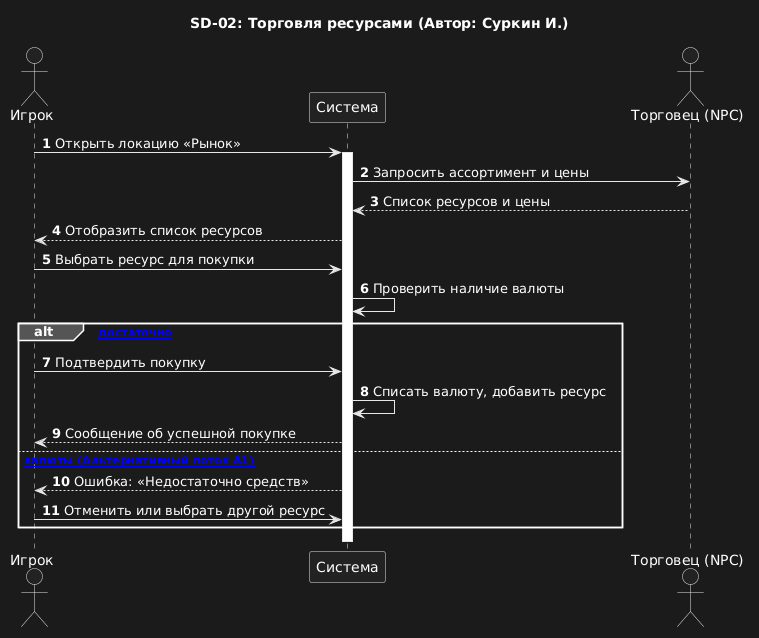

# Общий отчёт по проекту «Римско-Бразильская война»

**Статус Word-версии:** Сверена с Markdown перед сдачей.  
**Ссылка на Word-версию:** [report.docx](report.docx)

## Оглавление
1. [Назначение и целевая аудитория](#1-назначение-и-целевая-аудитория)
2. [Функциональные требования](#2-функциональные-требования)
3. [Нефункциональные требования](#3-нефункциональные-требования)
4. [Варианты использования (Use Cases)](#4-варианты-использования)
5. [Диаграммы](#5-диаграммы)
6. [Индивидуальные отчёты участников](#6-индивидуальные-отчёты-участников)

---

## 1. Назначение и целевая аудитория
**Назначение системы:** Создание коммерческого развлекательного продукта (компьютерной игры) для получения прибыли. Игра представляет собой стратегический экшен от 2-го лица в альтернативно-историческом сеттинге «Римско-Бразильская война в Японии».

**Целевая аудитория игры:** мужчины от 18 до 32 лет, интересующиеся стратегиями и альтернативной историей. Им нужен качественный развлекательный продукт с необычным сюжетом (Рим против Бразилии в Японии), стратегической глубиной (управление войсками, строительство, торговля), высокой 3D-графикой с реалистичными эффектами и режимом от 2-го лица. Доступность на Windows, macOS и Linux, а также удобная покупка через Steam или на дисках.

## 2. Функциональные требования
1. **Управление офицером бразильской армии от 2-го лица**

    Игрок управляет персонажем - офицером бразильской армии. Камера и управление организованы от второго лица: игрок видит персонажа со стороны союзника, но при этом непосредственно управляет его действиями. Это отличает игру от классического вида от первого лица и формирует особый стиль взаимодействия с миром.

2. В игре должны быть реализованы боевые столкновения между бразильской и римской армиями. Сражения происходят в локациях на территории Японии. Боевая система должна поддерживать участие игрока в боях, управление подразделениями и взаимодействие с противником.

    Взаимодействие с противником включает:
    - прямой бой и управление отрядами;
    - фланговые атаки, засады, дистанционный бой;
    - мораль противника: паника, бегство, плен;
    - захват командиров и использование окружения;
    - экономическое давление и захват провинций;
    - дипломатия и сюжетное противостояние.

3. **Стратегическое размещение войск на поле боя**

    Игрок должен иметь возможность располагать свои войска на поле боя с учётом тактической обстановки. Это включает выбор позиций, перестроение, контроль зон и реагирование на действия противника.
    
4. **Торговля ресурсами**

    В игре должна присутствовать экономическая механика. Торговля может быть связана с развитием армии, строительством, снабжением или получением прибыли внутри игрового мира.

    - Покупка - при посещении локации «рынок» игрок может покупать за игровую валюту ресурсы.
    - Продажа - при посещении локации «рынок» игрок, имеющий какие-либо ресурсы, может их продать.
    - Обмен - возможен обмен ресурсами с другими фракциями или торговцами.
    - Влияние на армию - ресурсы используются для пополнения войск, строительства и снабжения.
5. **Грабёж вражеских караванов**

    Игроку должна быть доступна возможность нападать на вражеские караваны и грабить их. Это дополнительная боевая/экономическая механика, которая может приносить ресурсы, влиять на снабжение противника или открывать новые тактические возможности.

6. **Строительство зданий в провинциях**

    В игре должна быть реализована система строительства. Игрок может возводить здания за игровую валюту, что влияет на развитие, экономику, оборону или другие аспекты игры.
7. **Разбивка нового лагеря при захвате новой провинции**
    При захвате новой провинции игрок должен получать возможность разбить там новый лагерь. Это механика прогрессии: каждая новая территория становится опорным пунктом для дальнейших действий.
8. **Использование карты - только Япония**

    Игрок может использовать карту для просмотра местности.
    
    Возможности карты:
    - просмотр местности и навигация;
    - отметки войск, лагерей, рынков и ресурсов;
    - разведка данных о противнике;
    - стратегическое планирование: атака, оборона, торговля;
    - карта ограничена территорией Японии.

## 3. Нефункциональные требования
1. **Поддержка Windows, macOS и Linux**

    Игра должна быть разработана и выпущена для трёх операционных систем: Windows, macOS и Linux. Это требование к кроссплатформенности и совместимости.

2. **Использование движка Unity**

    Разработка должна вестись на игровом движке Unity. Это определяет технологический стек, инструменты и подход к реализации.

3. **3D-графика с высокими текстурами**

    Игра должна использовать трёхмерную графику. Текстуры должны быть высокого качества. Это требование к визуальному уровню продукта.

4. **Наличие реалистичных отражений (видимость отражения игрока в воде)**
    
    В игре должны быть реализованы графические эффекты отражений. В частности, игрок должен видеть своё отражение в воде. Это требование к качеству графики и реалистичности окружения.
    
5. **Защита Denuvo**

    Для защиты игры должна использоваться система Denuvo. Это требование к защите от несанкционированного доступа и пиратства.

## 4. Варианты использования
### UC-01. Ведение сражения с римской армией (Панкратов И.)
**Описание:**
    Игрок в роли офицера бразильской армии вступает в бой с римскими войсками на территории Японии. Цель - победить противника, управляя своими отрядами и взаимодействуя с врагом.

**Действующие лица:**
Игрок (офицер бразильской армии), ИИ римской армии.

**Предусловия:**
Игрок находится на поле боя. Сражение началось. У игрока есть хотя бы один отряд.

**Основной поток:**
1. Игрок осматривает поле боя и расположение римских войск.
2. Игрок отдаёт приказы своим отрядам: атака, оборона, перестроение.
3. Система отображает перемещение отрядов и их взаимодействие с противником.
4. Игрок замечает слабый фланг римской армии.
5. Игрок приказывает кавалерии обойти фланг.
6. Система рассчитывает столкновение: учитываются тип юнита, броня, построение, усталость.
7. ИИ римской армии пытается контратаковать или перестроиться.
8. Игрок вводит резерв и усиливает натиск.
9. Мораль римского отряда падает, отряд бежит.
10. Игрок преследует отступающих или даёт им уйти.
11. Система фиксирует победу игрока в сражении.

**Альтернативные потоки:**

A1. Поражение игрока

12. Игрок теряет все отряды.
13. Система фиксирует поражение.
14. Игрок возвращается к последнему сохранению или начинает бой заново.

A2. Захват командира противника

15. В ходе боя игрок окружает римского командира.
16. Система предлагает вариант: ранить или захватить.
17. Игрок выбирает захват.
18. Система фиксирует пленение и даёт бонус к морали.
19. Сюжет получает новую ветку.

A3. Отступление игрока

20. Игрок понимает, что бой проигран.
21. Игрок отдаёт приказ на отступление.
22. Система позволяет вывести уцелевшие отряды.
23. Римская армия может преследовать игрока.

A4. Использование окружения

24. Игрок заманивает римлян в болото или ущелье.
25. Система применяет штрафы к противнику: замедление, потеря строя.
26. Игрок атакует ослабленного противника.
27. Постусловия:
28. Сражение завершено.
29. Победитель определён.
30. Игрок получает опыт, ресурсы или новые провинции.
31. Сюжет продвигается в зависимости от результата.

Связь с функциональным требованием: п. 2 «Ведение сражений с римской армией на территории Японии».

### UC-02. Торговля ресурсами (Суркин И.)
**Описание:** игрок посещает рынок и совершает покупку, продажу или обмен ресурсов. Цель — получить ресурсы для развития армии, строительства или снабжения.

**Действующие лица:** игрок, торговец (NPC).

**Предусловия:** игрок находится в локации «рынок», у него есть игровая валюта или ресурсы.

**Основной поток (покупка):**
1. Игрок открывает локацию «рынок».
2. Система отображает список доступных ресурсов и цены.
3. Игрок выбирает ресурс для покупки.
4. Система проверяет наличие достаточной валюты.
5. Игрок подтверждает покупку.
6. Система списывает валюту и добавляет ресурс в инвентарь игрока.
7. Система отображает сообщение об успешной покупке.

**Альтернативные потоки:**
- **A1. Недостаточно валюты**
  1. Игрок выбирает ресурс.
  2. Система обнаруживает нехватку валюты.
  3. Система отображает сообщение «Недостаточно средств».
  4. Игрок выбирает другой ресурс или отменяет покупку.
- **A2. Продажа ресурсов**
  1. Игрок выбирает ресурс в инвентаре для продажи.
  2. Система отображает цену продажи.
  3. Игрок подтверждает продажу.
  4. Система списывает ресурс и добавляет валюту.
  5. Система отображает сообщение об успешной продаже.
- **A3. Обмен ресурсами**
  1. Игрок выбирает обмен с другой фракцией или торговцем.
  2. Система отображает условия обмена.
  3. Игрок подтверждает обмен.
  4. Система обменивает ресурсы.

**Постусловия:**
- Игрок получил или продал ресурсы.
- Валюта и инвентарь обновлены.
- Игрок может продолжить торговлю или покинуть рынок.

**Связь с требованием:** «Торговля ресурсами».
### UC-03. Использование карты (Игнатушин В.)
**Описание:** игрок открывает карту для просмотра местности, навигации и стратегического планирования. Карта ограничена территорией Японии.

**Действующие лица:** игрок.

**Предусловия:** игрок находится в стратегическом режиме или на глобальной карте.

**Основной поток:**
1. Игрок открывает карту.
2. Карта отображает все провинции.
3. Игрок выбирает провинцию.
4. Система отображает местность: рельеф, леса, реки, горы, дороги.
5. Система отображает данные: свои войска, лагеря, рынки, ресурсы.
6. Игрок закрывает карту.

**Альтернативные потоки:**
- **A1. Просмотр разведданных**
  1. Игрок проверяет разведанные данные о противнике.
  2. Игрок планирует дальнейшие действия: атаку, оборону или торговый маршрут.
  3. Игрок закрывает карту или переходит к выбранной локации.
- **A2. Неразведанная территория**
  1. Игрок выбирает регион, о котором нет данных.
  2. Система отображает туман войны.
  3. Игрок отправляет разведку.
  4. Система раскрывает данные о регионе.
- **A3. Отсутствие доступных маршрутов**
  1. Игрок выбирает провинцию для перемещения.
  2. Система обнаруживает, что путь заблокирован.
  3. Система сообщает «Маршрут недоступен».
  4. Игрок выбирает другой маршрут.

**Постусловия:**
- Игрок получил информацию о местности и противнике.
- Игрок может принять стратегическое решение.
- Карта остаётся доступной для дальнейшего использования.

**Связь с требованием:** «Использование карты — только Япония».

### UC-04. Грабёж вражеского каравана (Панкратов И.)
**Описание:** игрок в роли офицера бразильской армии обнаруживает вражеский караван на территории Японии и нападает на него, чтобы получить ресурсы, ослабить снабжение противника или открыть новую тактическую возможность.

**Действующие лица:** игрок (офицер бразильской армии), ИИ охраны каравана, ИИ римской армии.

**Предусловия:** игрок находится на стратегической карте или в локации с караваном, у него есть хотя бы один боеспособный отряд. Караван не уничтожен и не находится под защитой непреодолимых сил противника.

**Основной поток:**
1. Игрок получает информацию о перемещении вражеского каравана.
2. Игрок выбирает караван как цель и отдаёт приказ на перехват.
3. Система перемещает отряд игрока к точке перехвата.
4. Система отображает состав охраны каравана и его груз.
5. Игрок начинает бой с охраной каравана.
6. Система рассчитывает столкновение с учётом типов юнитов, построения и усталости.
7. Игрок побеждает охрану каравана.
8. Система отображает доступные ресурсы для грабежа.
9. Игрок подтверждает грабёж.
10. Система добавляет ресурсы в инвентарь игрока и уменьшает снабжение противника.
11. Система фиксирует успешный грабёж и возможные последствия для сюжета.

**Альтернативные потоки:**
- **A1. Караван охраняется слишком сильным отрядом**
  1. Игрок начинает бой с охраной каравана.
  2. Система обнаруживает значительное превосходство противника.
  3. Игрок отдаёт приказ на отступление.
  4. Система позволяет вывести уцелевшие отряды.
  5. Караван продолжает движение.
- **A2. Засада со стороны римской армии**
  1. Игрок нападает на караван.
  2. Система активирует скрытый отряд римской армии.
  3. Игрок оказывается в окружении.
  4. Игрок выбирает: принять бой или прорваться.
  5. Система рассчитывает результат в зависимости от выбора.

**Постусловия:**
- Караван разграблен или уничтожен.
- Игрок получил ресурсы или понёс потери.
- Снабжение противника ослаблено.
- Сюжет может получить новую ветку или осложнение.

**Связь с требованием:** «Грабёж вражеских караванов».

### UC-05. Строительство зданий в провинции (Суркин И.)
**Описание:** игрок развивает захваченную или контролируемую провинцию, возводя здания за игровую валюту. Строительство влияет на экономику, оборону, снабжение и дальнейшие военные возможности.

**Действующие лица:** игрок, система строительства.

**Предусловия:** игрок контролирует провинцию, у него есть достаточное количество валюты или ресурсов. Провинция не находится в состоянии активного боя.

**Основной поток:**
1. Игрок открывает меню провинции.
2. Система отображает доступные здания и их стоимость.
3. Игрок выбирает здание для строительства.
4. Система проверяет наличие достаточной валюты и ресурсов.
5. Игрок подтверждает строительство.
6. Система списывает валюту и ресурсы.
7. Система запускает таймер строительства.
8. По завершении таймера система отображает готовое здание.
9. Система применяет эффект здания: экономика, оборона, снабжение или иные бонусы.

**Альтернативные потоки:**
- **A1. Недостаточно валюты или ресурсов**
  1. Игрок выбирает здание.
  2. Система обнаруживает нехватку валюты или ресурсов.
  3. Система отображает сообщение «Недостаточно средств для строительства».
  4. Игрок выбирает другое здание или отменяет строительство.
- **A2. Провинция атакована во время строительства**
  1. Игрок запускает строительство.
  2. Система фиксирует начало строительства.
  3. Провинция подвергается атаке.
  4. Система приостанавливает или отменяет строительство.
  5. Игрок должен защитить провинцию или потерять вложенные ресурсы.
- **A3. Улучшение существующего здания**
  1. Игрок выбирает уже построенное здание.
  2. Система отображает варианты улучшения.
  3. Игрок подтверждает улучшение.
  4. Система списывает ресурсы и запускает улучшение.
  5. Система применяет улучшенные эффекты.

**Постусловия:**
- Здание построено или улучшено.
- Валюта и ресурсы обновлены.
- Провинция получила новые возможности.
- Игрок может продолжить развитие провинции.

**Связь с требованием:** «Строительство зданий в провинциях».

### UC-06. Разбивка нового лагеря при захвате провинции (Игнатушин В.)
**Описание:** после захвата новой провинции игрок получает возможность разбить там новый лагерь. Лагерь становится опорным пунктом для дальнейших действий, снабжения и продвижения по территории Японии.

**Действующие лица:** игрок, система провинций, ИИ противника.

**Предусловия:** игрок успешно захватил новую провинцию, она не находится под контролем противника. У игрока есть необходимые ресурсы для разбивки лагеря.

**Основной поток:**
1. Игрок завершает захват провинции.
2. Система отображает сообщение о возможности разбить лагерь.
3. Игрок выбирает место для лагеря.
4. Система проверяет пригодность места.
5. Игрок подтверждает разбивку лагеря.
6. Система списывает необходимые ресурсы.
7. Система создаёт лагерь и отображает его на карте.
8. Система применяет эффекты лагеря: снабжение, восстановление войск, оборона.
9. Лагерь становится доступен для дальнейших действий игрока.

**Альтернативные потоки:**
- **A1. Недостаточно ресурсов для лагеря**
  1. Игрок выбирает место для лагеря.
  2. Система обнаруживает нехватку ресурсов.
  3. Система отображает сообщение «Недостаточно ресурсов для разбивки лагеря».
  4. Игрок откладывает разбивку или ищет ресурсы.
- **A2. Провинция снова атакована противником**
  1. Игрок начинает разбивку лагеря.
  2. Система фиксирует начало создания лагеря.
  3. Противник атакует провинцию.
  4. Система приостанавливает создание лагеря.
  5. Игрок должен защитить провинцию или потерять лагерь.
- **A3. Лагерь разбит в стратегически неудачном месте**
  1. Игрок выбирает место для лагеря.
  2. Система предупреждает о невыгодном расположении.
  3. Игрок подтверждает выбор.
  4. Система создаёт лагерь, но со штрафами к обороне или снабжению.
  5. Игрок может позже перенести лагерь при наличии ресурсов.

**Постусловия:**
- Лагерь создан или отменён.
- Провинция получила опорный пункт.
- Игрок может использовать лагерь для дальнейших операций.
- Сюжет и стратегическая карта обновлены.

**Связь с требованием:** «Разбивка нового лагеря при захвате новой провинции».

## 5. Диаграммы
*(Здесь будут ссылки на изображения, когда ты их перенесёшь в docs/img/)*
- Диаграмма вариантов использования: 
- Диаграмма последовательности SD-01: 
- Диаграмма последовательности SD-02: 
- Диаграмма последовательности SD-03: 

## 6. Индивидуальные отчёты участников
| Участник | Выполненная часть | Markdown | Word |
|----------|-------------------|----------|------|
| Панкратов И. | UC-01, UC-04 | [md/pankratov-report.md](md/pankratov-report.md) | [doc/pankratov-report.docx](doc/pankratov-report.docx) |
| Суркин И. | UC-02, UC-05, организация репозитория | [md/surkin-report.md](md/surkin-report.md) | [doc/surkin-report.docx](doc/surkin-report.docx) |
| Игнатушин В. | UC-03, UC-06 | [md/ignatushin-report.md](md/ignatushin-report.md) | [doc/ignatushin-report.docx](doc/ignatushin-report.docx) |