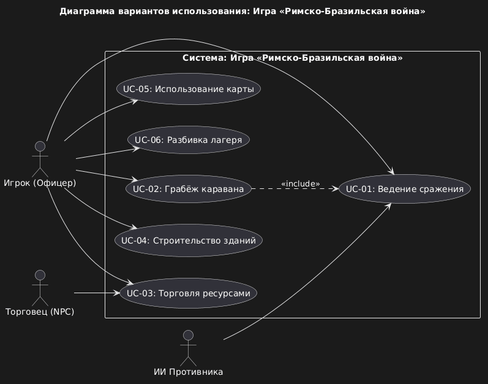
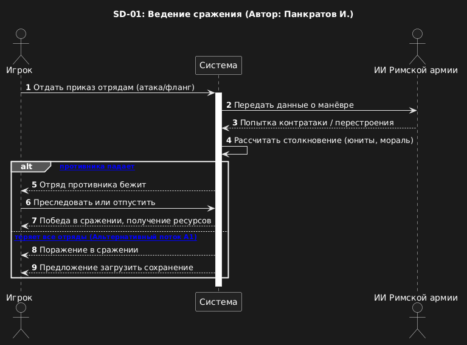

# Общий отчёт по проекту «Римско-Бразильская война»

**Статус Word-версии:** Сверена с Markdown перед сдачей.  
**Ссылка на Word-версию:** [report.docx](report.docx)

## Оглавление
1. [Назначение и целевая аудитория](#1-назначение-и-целевая-аудитория)
2. [Функциональные требования](#2-функциональные-требования)
3. [Нефункциональные требования](#3-нефункциональные-требования)
4. [Варианты использования (Use Cases)](#4-варианты-использования)
5. [Диаграммы](#5-диаграммы)
6. [Индивидуальные отчёты участников](#6-индивидуальные-отчёты-участников)

---

## 1. Назначение и целевая аудитория
**Назначение системы:** Создание коммерческого развлекательного продукта (компьютерной игры) для получения прибыли. Игра представляет собой стратегический экшен от 2-го лица в альтернативно-историческом сеттинге «Римско-Бразильская война в Японии».

**Целевая аудитория игры:** мужчины от 18 до 32 лет, интересующиеся стратегиями и альтернативной историей. Им нужен качественный развлекательный продукт с необычным сюжетом (Рим против Бразилии в Японии), стратегической глубиной (управление войсками, строительство, торговля), высокой 3D-графикой с реалистичными эффектами и режимом от 2-го лица. Доступность на Windows, macOS и Linux, а также удобная покупка через Steam или на дисках.

## 2. Функциональные требования
1. **Управление офицером бразильской армии от 2-го лица**

    Игрок управляет персонажем - офицером бразильской армии. Камера и управление организованы от второго лица: игрок видит персонажа со стороны союзника, но при этом непосредственно управляет его действиями. Это отличает игру от классического вида от первого лица и формирует особый стиль взаимодействия с миром.

2. В игре должны быть реализованы боевые столкновения между бразильской и римской армиями. Сражения происходят в локациях на территории Японии. Боевая система должна поддерживать участие игрока в боях, управление подразделениями и взаимодействие с противником.

    Взаимодействие с противником включает:
    - прямой бой и управление отрядами;
    - фланговые атаки, засады, дистанционный бой;
    - мораль противника: паника, бегство, плен;
    - захват командиров и использование окружения;
    - экономическое давление и захват провинций;
    - дипломатия и сюжетное противостояние.

3. **Стратегическое размещение войск на поле боя**

    Игрок должен иметь возможность располагать свои войска на поле боя с учётом тактической обстановки. Это включает выбор позиций, перестроение, контроль зон и реагирование на действия противника.
    
4. **Торговля ресурсами**

    В игре должна присутствовать экономическая механика. Торговля может быть связана с развитием армии, строительством, снабжением или получением прибыли внутри игрового мира.

    - Покупка - при посещении локации «рынок» игрок может покупать за игровую валюту ресурсы.
    - Продажа - при посещении локации «рынок» игрок, имеющий какие-либо ресурсы, может их продать.
    - Обмен - возможен обмен ресурсами с другими фракциями или торговцами.
    - Влияние на армию - ресурсы используются для пополнения войск, строительства и снабжения.
5. **Грабёж вражеских караванов**

    Игроку должна быть доступна возможность нападать на вражеские караваны и грабить их. Это дополнительная боевая/экономическая механика, которая может приносить ресурсы, влиять на снабжение противника или открывать новые тактические возможности.

6. **Строительство зданий в провинциях**

    В игре должна быть реализована система строительства. Игрок может возводить здания за игровую валюту, что влияет на развитие, экономику, оборону или другие аспекты игры.
7. **Разбивка нового лагеря при захвате новой провинции**
    При захвате новой провинции игрок должен получать возможность разбить там новый лагерь. Это механика прогрессии: каждая новая территория становится опорным пунктом для дальнейших действий.
8. **Использование карты - только Япония**

    Игрок может использовать карту для просмотра местности.
    
    Возможности карты:
    - просмотр местности и навигация;
    - отметки войск, лагерей, рынков и ресурсов;
    - разведка данных о противнике;
    - стратегическое планирование: атака, оборона, торговля;
    - карта ограничена территорией Японии.

## 3. Нефункциональные требования
1. **Поддержка Windows, macOS и Linux**

    Игра должна быть разработана и выпущена для трёх операционных систем: Windows, macOS и Linux. Это требование к кроссплатформенности и совместимости.

2. **Использование движка Unity**

    Разработка должна вестись на игровом движке Unity. Это определяет технологический стек, инструменты и подход к реализации.

3. **3D-графика с высокими текстурами**

    Игра должна использовать трёхмерную графику. Текстуры должны быть высокого качества. Это требование к визуальному уровню продукта.

4. **Наличие реалистичных отражений (видимость отражения игрока в воде)**
    
    В игре должны быть реализованы графические эффекты отражений. В частности, игрок должен видеть своё отражение в воде. Это требование к качеству графики и реалистичности окружения.
    
5. **Защита Denuvo**

    Для защиты игры должна использоваться система Denuvo. Это требование к защите от несанкционированного доступа и пиратства.

## 4. Варианты использования
### UC-01. Ведение сражения с римской армией (Панкратов И.)
**Описание:**
    Игрок в роли офицера бразильской армии вступает в бой с римскими войсками на территории Японии. Цель - победить противника, управляя своими отрядами и взаимодействуя с врагом.

**Действующие лица:**
Игрок (офицер бразильской армии), ИИ римской армии.

**Предусловия:**
Игрок находится на поле боя. Сражение началось. У игрока есть хотя бы один отряд.

**Основной поток:**
1. Игрок осматривает поле боя и расположение римских войск.
2. Игрок отдаёт приказы своим отрядам: атака, оборона, перестроение.
3. Система отображает перемещение отрядов и их взаимодействие с противником.
4. Игрок замечает слабый фланг римской армии.
5. Игрок приказывает кавалерии обойти фланг.
6. Система рассчитывает столкновение: учитываются тип юнита, броня, построение, усталость.
7. ИИ римской армии пытается контратаковать или перестроиться.
8. Игрок вводит резерв и усиливает натиск.
9. Мораль римского отряда падает, отряд бежит.
10. Игрок преследует отступающих или даёт им уйти.
11. Система фиксирует победу игрока в сражении.

**Альтернативные потоки:**

A1. Поражение игрока

12. Игрок теряет все отряды.
13. Система фиксирует поражение.
14. Игрок возвращается к последнему сохранению или начинает бой заново.

A2. Захват командира противника

15. В ходе боя игрок окружает римского командира.
16. Система предлагает вариант: ранить или захватить.
17. Игрок выбирает захват.
18. Система фиксирует пленение и даёт бонус к морали.
19. Сюжет получает новую ветку.

A3. Отступление игрока

20. Игрок понимает, что бой проигран.
21. Игрок отдаёт приказ на отступление.
22. Система позволяет вывести уцелевшие отряды.
23. Римская армия может преследовать игрока.

A4. Использование окружения

24. Игрок заманивает римлян в болото или ущелье.
25. Система применяет штрафы к противнику: замедление, потеря строя.
26. Игрок атакует ослабленного противника.
27. Постусловия:
28. Сражение завершено.
29. Победитель определён.
30. Игрок получает опыт, ресурсы или новые провинции.
31. Сюжет продвигается в зависимости от результата.

Связь с функциональным требованием: п. 2 «Ведение сражений с римской армией на территории Японии».

### UC-02. Торговля ресурсами (Суркин И.)
*(Вставь своё описание)*

### UC-03. Использование карты (Игнатушин В.)
*(Вставь описание)*

### UC-04. Грабёж вражеского каравана (Панкратов И.)
*(Вставь описание)*

### UC-05. Строительство зданий в провинции (Суркин И.)
*(Вставь своё описание)*

### UC-06. Разбивка нового лагеря при захвате провинции (Игнатушин В.)
*(Вставь описание)*

## 5. Диаграммы
*(Здесь будут ссылки на изображения, когда ты их перенесёшь в docs/img/)*
- Диаграмма вариантов использования: 
- Диаграмма последовательности SD-01: 
- Диаграмма последовательности SD-02: 
- Диаграмма последовательности SD-03: 

## 6. Индивидуальные отчёты участников
| Участник | Выполненная часть | Markdown | Word |
|----------|-------------------|----------|------|
| Панкратов И. | UC-01, UC-04 | [md/pankratov-report.md](md/pankratov-report.md) | [doc/pankratov-report.docx](doc/pankratov-report.docx) |
| Суркин И. | UC-02, UC-05, организация репозитория | [md/surkin-report.md](md/surkin-report.md) | [doc/surkin-report.docx](doc/surkin-report.docx) |
| Игнатушин В. | UC-03, UC-06 | [md/ignatushin-report.md](md/ignatushin-report.md) | [doc/ignatushin-report.docx](doc/ignatushin-report.docx) |